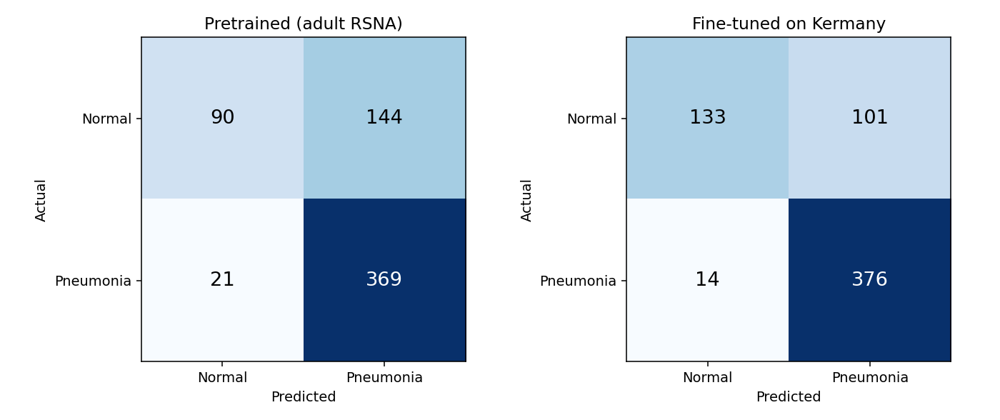

# Explainable Pneumonia Screening with Anatomy-Grounded Reports

A deep-learning pipeline that screens pediatric chest X-rays for pneumonia and produces a **structured, auditable clinical-style report**. Every sentence in the report comes from a measured value, so nothing is free-text generated.

Built on [TorchXRayVision](https://github.com/mlmed/torchxrayvision) (Cohen et al., MIDL 2022). This project adds:

1. **Domain adaptation:** an adult-trained pneumonia model is fine-tuned on the pediatric Kermany dataset, with a decision threshold tuned for high recall.
2. **Anatomy-grounded explainability:** Grad-CAM attention is mapped onto segmented lung zones and checked for reliability.
3. **Coarse-to-fine report generation:** a deterministic, measurement-driven report with a PDF export and an interactive web demo.

> ⚠️ **Research and education prototype only. This is not a medical device and must not be used for clinical decisions.**

---

## Table of contents
- [Results](#results)
- [Pipeline](#pipeline)
- [Methodology](#methodology)
- [Datasets](#datasets)
- [Repository structure](#repository-structure)
- [Installation](#installation)
- [Usage](#usage)
- [Design decisions](#design-decisions)
- [Limitations](#limitations)
- [References](#references)

---

## Results

Evaluated on the official Kermany **test set** (624 images: 234 normal, 390 pneumonia). The test set was never used during training or threshold selection.

| Metric | Pretrained (adult RSNA) | **Fine-tuned (ours)** |
|---|---|---|
| Decision threshold | 0.50 | **0.256** (recall-tuned) |
| Accuracy | 73.6% | **81.6%** |
| Recall (sensitivity) | 94.6% | **96.4%** |
| Specificity | 38.5% | **56.8%** |
| Precision | 71.9% | **78.8%** |
| ROC-AUC | 0.824 | **0.904** |
| Missed pneumonia (FN) | 21 | **14** |
| False alarms (FP) | 144 | **101** |

<p align="center"></p>

**Report pipeline with the safety gates applied:**

| Metric | Value |
|---|---|
| Referral rate (REFER verdicts) | 58.3% |
| Accuracy on non-referred cases | **92.7%** |
| Recall on non-referred cases | 95.6% |
| Agreement between the main and second-opinion models | 34.5% |
| Mean in-lung attention (pneumonia cases) | 49.7% |

The system decides about 42% of cases on its own with about 93% accuracy and defers the uncertain remainder to a radiologist. Most referrals come from disagreement with the adult-trained second-opinion model (see [Limitations](#limitations)).

---

## Pipeline

```
Chest X-ray
  ├─► Main model: DenseNet-121 (RSNA weights, frozen) + Kermany-trained head ─► P(pneumonia) + Grad-CAM
  ├─► Second model: DenseNet-121 "all" (7 datasets) ─► P(pneumonia) + Grad-CAM + 17 other findings
  ├─► Segmentation: PSPNet anatomy model ─► left / right lung ─► 6 zones (upper / middle / lower)
  ├─► Measurements: attention per zone, % attention inside lungs, extent per lung,
  │                 inter-model location IoU, relative opacity
  └─► Report: L1 verdict ─► L2 section plan ─► L3 measured slots ─► L4 template sentences ─► PDF
```

---

## Methodology

### 1. Transfer learning (one trainable layer)
- **Backbone:** TorchXRayVision DenseNet-121 pretrained on the RSNA Pneumonia dataset (adult). All 121 layers are **frozen**.
- **New head:** a single `Linear(1024 → 1)` layer (**1,025 trainable parameters**) trained on globally pooled DenseNet features.
- **Why so small:** the frozen backbone already encodes radiographic features. A single linear layer adapts the model to the pediatric domain without overfitting about 4.4k training images.
- **Training details:**
  - Optimizer: Adam (lr = 1e-3, weight decay = 1e-4), batch size 64, 30 epochs.
  - Loss: `BCEWithLogitsLoss` with `pos_weight` = N<sub>normal</sub>/N<sub>pneumonia</sub> to correct for class imbalance.
  - Model selection: the epoch with the best validation AUC (0.939).

### 2. Data split
| Split | Images | Source |
|---|---|---|
| Train | 4,448 | Random 85% of the official `train/` folder (seed 42) |
| Validation | 784 | Remaining 15%, used for model selection and threshold tuning |
| Test | 624 | Official `test/` folder, held out for final evaluation |

### 3. Recall-tuned threshold
On the validation set, the threshold is set to the **highest value that still achieves recall ≥ 0.95** (result: 0.256). In screening, a missed pneumonia costs more than a false alarm.

### 4. Explainability: Grad-CAM to lung zones
- **Grad-CAM** is computed on the final DenseNet feature block (1024 × 7 × 7), upsampled to 224 × 224 and normalised to [0, 1].
- **PSPNet** (trained on ChestX-Det) segments the left and right lungs. Each lung is split into upper, middle and lower thirds of its own height, giving 6 zones.
- **Measurements taken from the maps:**
  - attention share per zone;
  - % of attention inside the lung fields;
  - extent of the highlighted area per lung;
  - IoU between the two models' highlighted regions;
  - relative opacity of the highlighted tissue.

### 5. Coarse-to-fine report generation
The report text is produced by **deterministic slot filling, not a language model**:

| Level | Step | Output |
|---|---|---|
| L1 | Verdict | `PNEUMONIA LIKELY`, `NO PNEUMONIA DETECTED` or `REFER` (rule-based gates, below) |
| L2 | Section plan | Which sections are needed (e.g. *Location* only when pneumonia is suspected) |
| L3 | Slot filling | Top zones (≥ 15% attention), laterality, extent, confidence band, agreement, other findings |
| L4 | Realisation | Template sentences filled with the measured values |

**REFER gates**, applied in order:
1. Lungs could not be segmented.
2. The model calls (or nearly calls) pneumonia, but less than 50% of its attention is inside the lungs. This is a shortcut-learning guard.
3. The main and second-opinion models disagree, and the main model is not highly confident.
4. The prediction is close to the decision threshold (low-confidence band).

---

## Datasets

| Dataset | Population | Role in this project |
|---|---|---|
| **[Kermany et al. – ChestXRay2017](https://data.mendeley.com/datasets/rscbjbr9sj/2)** | 5,856 pediatric CXRs (ages 1–5), Guangzhou Women and Children's Medical Center | **Fine-tuning and evaluation** (included in `data/`) |
| RSNA Pneumonia Detection Challenge | ~26k adult CXRs (NIH ChestX-ray14) | Pretraining of the main model (weights via TorchXRayVision) |
| TorchXRayVision "all" | NIH, CheXpert, MIMIC-CXR, PadChest, RSNA, Google, OpenI | Pretraining of the second-opinion model |
| ChestX-Det | NIH CXRs with pixel-level anatomy masks | Pretraining of the PSPNet segmentation model |

**Why Kermany:** it is a public, clearly labelled and widely used benchmark. Its pediatric population differs from the adult data the backbone was trained on, and that domain shift is what motivates the fine-tuning.

The Kermany images in `data/chest_xray/` are redistributed under their original **[CC BY 4.0](https://creativecommons.org/licenses/by/4.0/)** license. All credit goes to the original authors (see [References](#references)).

---

## Repository structure

```
.
├── report_engine.py                    # Models, preprocessing, Grad-CAM, segmentation, zones, measurements, report generator
├── report_pdf.py                       # 3-panel figure (X-ray / Grad-CAM / zones) and PDF export
├── finetune.py                         # Feature extraction, head training, recall-tuned threshold selection
├── evaluate.py                         # Test-set metrics, confusion matrices, report-pipeline statistics
├── app.py                              # Streamlit web demo
├── Pneumonia_Explainable_Report.ipynb  # End-to-end Google Colab notebook
├── requirements.txt
├── data/chest_xray/                    # Kermany dataset: train/ and test/, each with NORMAL/ and PNEUMONIA/
├── weights/
│   ├── kermany_head.pt                 # Trained classification head
│   └── threshold.json                  # Recall-tuned threshold and validation AUC
└── results/
    ├── metrics.json                    # Test-set metrics
    └── confusion.png                   # Confusion matrices
```

---

## Installation

Tested with Python 3.13 and PyTorch 2.6.0 (CUDA 12.6), on an NVIDIA RTX 2050 (4 GB) and on CPU.

```bash
git clone https://github.com/syamthani07/DL-PROJECT.git
cd DL-PROJECT

# Optional, for GPU acceleration: install the CUDA build of PyTorch first
pip install torch==2.6.0 torchvision==0.21.0 --index-url https://download.pytorch.org/whl/cu126

pip install -r requirements.txt
```

Pretrained TorchXRayVision weights download automatically the first time the code runs.

---

## Usage

**Web demo:** upload an X-ray to get the verdict, heat map, lung zones, the report and a PDF download.
```bash
streamlit run app.py
```

**Single image from the command line:**
```bash
python report_engine.py data/chest_xray/test/PNEUMONIA/person100_bacteria_475.jpeg
```

**Reproduce training** (about 5 min on GPU, 20–30 min on CPU):
```bash
python finetune.py --data data/chest_xray --out weights
```

**Reproduce evaluation:**
```bash
python evaluate.py --data data/chest_xray --head weights/kermany_head.pt
# quick check on a subset: add --limit 50
```

**Google Colab:** open `Pneumonia_Explainable_Report.ipynb`, set the runtime to a T4 GPU, and run all cells.

---

## Design decisions

| Question | Answer |
|---|---|
| **Why templates instead of an LLM for the report?** | A free-running language model can invent findings. Here every sentence maps to a measured value, so the report is fully auditable. |
| **Why coarse-to-fine generation?** | Inspired by Next-Concept Modeling (Stanford Hazy Research + Together AI), which generates text from a coarse skeleton down to fine detail. This project keeps the hierarchy but replaces the neural generator with deterministic slot filling. |
| **Why an attention-reliability check?** | Zech et al. (2018) showed that CNNs can learn hospital or scanner shortcuts. If less than 50% of the Grad-CAM attention lies inside the lungs, the prediction is not trusted. |
| **Why a second model?** | It acts as an independent "second reader" trained on different hospitals. Disagreement triggers a referral. |
| **Why a recall-tuned threshold?** | In screening, a missed pneumonia is more costly than a false alarm. |
| **Why freeze the backbone?** | It limits overfitting on a small dataset, trains in seconds, and keeps the general radiographic features learned from large adult datasets. |

---

## Limitations
- **Population mismatch:** the segmentation and second-opinion models were trained mostly on adult X-rays, while Kermany is pediatric. This is the main cause of the high referral rate.
- **Coarse localisation:** Grad-CAM comes from a 7 × 7 grid, so zone attention shares are approximate.
- **Segmentation failure modes:** lower zones may be under-segmented when the lung bases are completely opaque (dense consolidation or effusion).
- **Split granularity:** the train/validation split is per image, not per patient. Validation AUC may therefore be slightly optimistic; test-set metrics are the reference.
- **Single-centre data:** all Kermany images come from one hospital, so performance at other institutions is unknown.
- **Not clinically validated:** not a medical device.

---

## References
- Cohen, J. P., et al. *TorchXRayVision: A library of chest X-ray datasets and models.* MIDL 2022. [GitHub](https://github.com/mlmed/torchxrayvision)
- Kermany, D. S., et al. *Identifying Medical Diagnoses and Treatable Diseases by Image-Based Deep Learning.* Cell, 172(5), 2018. [Dataset](https://data.mendeley.com/datasets/rscbjbr9sj/2)
- Selvaraju, R. R., et al. *Grad-CAM: Visual Explanations from Deep Networks via Gradient-based Localization.* ICCV 2017.
- Zech, J. R., et al. *Variable generalization performance of a deep learning model to detect pneumonia in chest radiographs.* PLOS Medicine, 2018.
- Lian, J., et al. *A Structure-Aware Relation Network for Thoracic Diseases Detection and Segmentation (ChestX-Det).* IEEE TMI, 2021.
- Huang, G., et al. *Densely Connected Convolutional Networks.* CVPR 2017.
- Zhao, H., et al. *Pyramid Scene Parsing Network.* CVPR 2017.
